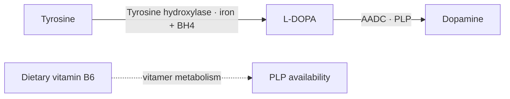

:::warning Demonstration only — not approved policy
This isolated page tests complementary dietary and biochemical explanations. Accepted classifications are reproduced, not revised. Added reaction context is not an admitted dietary atom. The live PM, ontology, KC/iKC decisions and SOP admissions remain authoritative.
:::

[All four demonstrations](/docs/system/dietary-requirements-demo) · [Canonical BRS1-FM1-PM3](/docs/biological-targets/brs1/fm1/brs1-fm1-pm3-dopaminergic-signalling-regulation)

## Defined mechanism

**Canonical mission:** Maintain appropriately regulated dopamine synthesis, storage, release, receptor signalling, reuptake and metabolism across changing functional demand.

The diagram identifies selected relationships; it is not a complete stoichiometric or whole-PM inventory. Dashed supply arrows do not assert quantitative conversion yields. [Accepted reaction/pathway evidence](/docs/biological-targets/brs1/fm1/brs1-fm1-pm3-dopaminergic-signalling-regulation#pm3-f1).

## 1.1 Dietary Requirements

Nutrition maintains capacity; the body also produces and regenerates reaction participants. Insufficiency, adequate provision and therapeutic enhancement are separate propositions. This parent heading does not make every participant below a dietary intake requirement.

### 1.1.1 Direct and/or Derived Dietary Requirements

**What nutrition provides.** Current accepted classifications are retained, including disagreements explicitly flagged below.

| Accepted input | Current classification | Dietary provision explanation — demonstration wording | Source decision and limitation | Evidence |
| --- | --- | --- | --- | --- |
| Tyrosine | direct | Dietary amino-acid provision supplies tyrosine upstream through PM1. Tyrosine is the initial input to dopamine synthesis. Adequate supply does not imply that additional intake improves dopamine signalling. | Yes; Substrate necessity does not establish that additional dietary tyrosine increases brain dopamine or improves a functional or clinical outcome. | [PM3-F1: Dopamine synthesis requires distinct substrate and cofactor steps](/docs/biological-targets/brs1/fm1/brs1-fm1-pm3-dopaminergic-signalling-regulation#pm3-f1); [PM3-F13: The shared LNAA pool presents tyrosine upstream of catecholamine synthesis](/docs/biological-targets/brs1/fm1/brs1-fm1-pm3-dopaminergic-signalling-regulation#pm3-f13) |
| Iron | direct | Dietary iron supports the mineral pool from which the hydroxylase obtains its cofactor. Its accepted capacity admission is retained. The reviewed deficiency evidence does not establish an extra-intake benefit in adequately nourished humans. | Yes; Human intake-to-dopamine responsiveness and clinical benefit were not established; the direct dopamine-metabolite evidence assessed here is preclinical deficiency evidence. | [PM3-F1: Dopamine synthesis requires distinct substrate and cofactor steps](/docs/biological-targets/brs1/fm1/brs1-fm1-pm3-dopaminergic-signalling-regulation#pm3-f1) |
| Pyridoxal 5′-phosphate (PLP; active vitamin B6 cofactor) | direct | PLP is the active target maintained through vitamin B6 metabolism. The source retains Direct capacity classification but does not establish independent dietary PLP delivery. This entry is shown for classification review, not as a second intake instruction. | Unset in source — classification review; Kennedy reviews B-vitamin roles in neurochemical synthesis; this does not establish dietary PLP provision or an intake-to-dopamine response in humans. | [PM3-F1: Dopamine synthesis requires distinct substrate and cofactor steps](/docs/biological-targets/brs1/fm1/brs1-fm1-pm3-dopaminergic-signalling-regulation#pm3-f1) |
| Vitamin B6 | derived → Pyridoxal 5′-phosphate (PLP; active vitamin B6 cofactor) | Dietary B6 vitamers provide an established route to active PLP availability. The accepted relationship is Derived → PLP. Neither conversion nor cofactor necessity establishes that additional B6 increases human brain dopamine. | Yes; Dietary B6 can supply PLP precursors, including vitamers that enter the central nervous system, but increasing B6 intake has not been shown to increase human brain dopamine synthesis. | [PM3-F1: Dopamine synthesis requires distinct substrate and cofactor steps](/docs/biological-targets/brs1/fm1/brs1-fm1-pm3-dopaminergic-signalling-regulation#pm3-f1) |

### 1.1.2 Cofactors and Substrates

**What the mechanism uses, and how availability is maintained.** Reaction context below is separated from admitted dietary supply. Repetition is justified only by the additional explanation in the fourth column.

| Participant | Biochemical role and step | Supply or regeneration | Information added beyond §1.1.1 | Evidence |
| --- | --- | --- | --- | --- |
| Tyrosine | Principal substrate: Tyrosine hydroxylase converts it to L-DOPA. | Dietary amino-acid supply via PM1, with separately recorded precursor/transport relationships. | Dietary provision above; enzyme-specific use here. | [PM3-F1: Dopamine synthesis requires distinct substrate and cofactor steps](/docs/biological-targets/brs1/fm1/brs1-fm1-pm3-dopaminergic-signalling-regulation#pm3-f1); [PM3-F13: The shared LNAA pool presents tyrosine upstream of catecholamine synthesis](/docs/biological-targets/brs1/fm1/brs1-fm1-pm3-dopaminergic-signalling-regulation#pm3-f13) |
| Iron | Cofactor: Required during tyrosine hydroxylation. | Dietary provision maintains body iron pools; intracellular handling determines enzyme availability. | Names the catalytic job instead of repeating a dietary prescription. | [PM3-F1: Dopamine synthesis requires distinct substrate and cofactor steps](/docs/biological-targets/brs1/fm1/brs1-fm1-pm3-dopaminergic-signalling-regulation#pm3-f1) |
| BH4 | Active organic cofactor: Supports tyrosine hydroxylase in the first synthesis step. | Endogenous synthesis and recycling; no admitted dietary BH4 supply. | Explains a required cofactor that diet does not directly have to supply. | [PM3-F1: Dopamine synthesis requires distinct substrate and cofactor steps](/docs/biological-targets/brs1/fm1/brs1-fm1-pm3-dopaminergic-signalling-regulation#pm3-f1) |
| L-DOPA | Intermediate and downstream substrate: Product of hydroxylation; substrate consumed by AADC to form dopamine. | Produced in the pathway from tyrosine. No dietary L-DOPA admission is created. | Demonstration-only biochemical context supported by PM3-F1; no canonical L-DOPA atom exists here. | [PM3-F1: Dopamine synthesis requires distinct substrate and cofactor steps](/docs/biological-targets/brs1/fm1/brs1-fm1-pm3-dopaminergic-signalling-regulation#pm3-f1) |
| PLP | Active AADC cofactor: Supports decarboxylation of L-DOPA to dopamine. | Maintained through B6 vitamer processing; ingested PLP reaching neuronal AADC unchanged is not established. | Explains enzyme-bound function, distinct from B6 provision. B6 is not a second AADC cofactor. | [PM3-F1: Dopamine synthesis requires distinct substrate and cofactor steps](/docs/biological-targets/brs1/fm1/brs1-fm1-pm3-dopaminergic-signalling-regulation#pm3-f1) |

### 1.1.3 Key Constraints

Existing identifiers, ownership and limitations are retained. An upstream supply or pool connection is not newly classified Direct/Derived. Pools are not additional nutrient quantities.

- **Monoamine precursor supply — BRS1(KC1)** (supported-upstream-supply; existing stored relationship): The reviewed pool supplies tyrosine for the dopamine synthesis reaction. The individual tyrosine disclosure is retained in Direct Requirements above; this KC record preserves its upstream provenance without a second copy. Individually reviewed phenylalanine-to-tyrosine conversion also replenishes that precursor supply.

  Limitation: Only tyrosine supply is admitted here. Phenylalanine publication awaits its individual source/context appraisal; tryptophan is not admitted as catecholamine supply. Competitive inadequacy as a limiting constraint remains unresolved.

  [PM3-F13: The shared LNAA pool presents tyrosine upstream of catecholamine synthesis](/docs/biological-targets/brs1/fm1/brs1-fm1-pm3-dopaminergic-signalling-regulation#pm3-f13); [PM3-F14: Phenylalanine replenishes tyrosine upstream of catecholamine synthesis](/docs/biological-targets/brs1/fm1/brs1-fm1-pm3-dopaminergic-signalling-regulation#pm3-f14)

- **Methyl-resource supply for COMT — BRS2(KC1)** (supported-upstream-supply; existing stored relationship): [BRS2 PM1 — Folate/B12 remethylation](/docs/biological-targets/brs2/fm1/brs2-fm1-pm1-folate-b12-dependent-homocysteine-remethylation) and [BRS2 PM2 — Betaine/BHMT remethylation](/docs/biological-targets/brs2/fm1/brs2-fm1-pm2-betaine-bhmt-remethylation) replenish methionine used by [BRS2 PM3 — SAM synthesis](/docs/biological-targets/brs2/fm1/brs2-fm1-pm3-same-synthesis); COMT uses SAM during dopamine metabolism.

  Limitation: This establishes the connected biochemical supply route, not a measured dietary effect on regional neural SAM or COMT clearance. BHMT is predominantly hepatic/renal; peripheral methionine contribution, local SAM synthesis, alternative supply and turnover vary by tissue. Donor inadequacy as a limiting constraint and benefit from extra intake in replete individuals remain unresolved.

  [PM3-F12: Remethylation supplies the methionine/SAM resource used by COMT](/docs/biological-targets/brs1/fm1/brs1-fm1-pm3-dopaminergic-signalling-regulation#pm3-f12)

## SOP boundary

Existing SOPs concern specified food preparation or dietary protocols and retain their own populations and evidence. Neither iron/B6 necessity nor tyrosine provision establishes an optimisation intervention or ADHD benefit.

### Existing SOP admissions — unchanged

- **Pair non-haem iron-containing meals with an ascorbic-acid source** (food_prep): Evidence supports improved non-haem iron absorption at the meal level; it does not establish improved iron status or any change in dopamine biology or function. [PM3-F8: Meal preparation can improve non-haem iron absorption](/docs/biological-targets/brs1/fm1/brs1-fm1-pm3-dopaminergic-signalling-regulation#pm3-f8)

- **Use validated phytate-reducing preparation methods for high-phytate cereals** (food_prep): Improved absorption was matrix-dependent and did not consistently translate into better long-term iron status; no dopamine-related outcome was measured. [PM3-F8: Meal preparation can improve non-haem iron absorption](/docs/biological-targets/brs1/fm1/brs1-fm1-pm3-dopaminergic-signalling-regulation#pm3-f8)

- **Short-term selective dietary-fat restriction in adults with obesity under controlled conditions** (dietary_protocols): Evidence comes from 17 adults with obesity in a short inpatient experiment; reduced binding potential does not by itself distinguish receptor change from greater endogenous dopamine occupancy. [PM3-F11: Short restrictive dietary protocols alter dopamine receptor binding in obesity](/docs/biological-targets/brs1/fm1/brs1-fm1-pm3-dopaminergic-signalling-regulation#pm3-f11)

- **Short-term very-low-calorie dieting in adults with obesity** (dietary_protocols): The uncontrolled study involved 15 women with obesity and cannot establish whether the imaging change reflects altered receptor availability or endogenous dopamine occupancy. [PM3-F11: Short restrictive dietary protocols alter dopamine receptor binding in obesity](/docs/biological-targets/brs1/fm1/brs1-fm1-pm3-dopaminergic-signalling-regulation#pm3-f11)

:::info Demonstration review notes
- The demonstration focuses on synthesis without narrowing the canonical mission: storage, release, receptors, reuptake and metabolism remain part of the PM.
- Iron has a retained dietary capacity admission; lack of therapeutic dose-response does not by itself revoke it.
- PLP Direct and B6 Derived are preserved as accepted classifications. Their presentation conflicts with interpreting Direct as independently admitted dietary supply of PLP.
- L-DOPA is added only as reaction explanation, not as an admitted dietary input.
- No quantitative dietary targets, precursor yields, new food lists or therapeutic benefits are inferred.
- Proposed reaction explanations remain preview-only until reviewed.
:::

Accepted dietary records and evidence — source audit

Source: `docs/biological-targets/brs1/fm1/brs1-fm1-pm3-dopaminergic-signalling-regulation.mdx`. Snapshot hash: `592f0a4e4178790a215bda296c0f8ce7bebd67dfca33c6650a32b11423eebdbb`. Reproduce these previews with `node scripts/generate-dietary-requirements-demos.mjs`; do not maintain a separate scientific registry here.

### PM3-DIT-5: Tyrosine

- Accepted biological role: Tyrosine is the substrate for conversion to L-DOPA in dopamine synthesis.
- Accepted layer: dietary-requirement; addressability: not-established; ceiling: biological-dependency.
- Limitation: Substrate necessity does not establish that additional dietary tyrosine increases brain dopamine or improves a functional or clinical outcome.
- Supply links: [Supply: BRS1-FM1-PM1](/docs/biological-targets/brs1/fm1/brs1-fm1-pm1-amino-acid-availability-and-prioritisation)
- Source evidence: [PM3-F1: Dopamine synthesis requires distinct substrate and cofactor steps](/docs/biological-targets/brs1/fm1/brs1-fm1-pm3-dopaminergic-signalling-regulation#pm3-f1); [PM3-F13: The shared LNAA pool presents tyrosine upstream of catecholamine synthesis](/docs/biological-targets/brs1/fm1/brs1-fm1-pm3-dopaminergic-signalling-regulation#pm3-f13)
- References: [fanet_tetrahydrobioterin_2021](/docs/papers/BRAIN-Diet-References#fanet_tetrahydrobioterin_2021); [fernstrom_lnna_2013](/docs/papers/BRAIN-Diet-References#fernstrom_lnna_2013)

### PM3-DIT-1: Iron

- Accepted biological role: Cofactor required by tyrosine hydroxylase during catecholamine synthesis
- Accepted layer: dietary-requirement; addressability: not-established; ceiling: biological-dependency.
- Limitation: Human intake-to-dopamine responsiveness and clinical benefit were not established; the direct dopamine-metabolite evidence assessed here is preclinical deficiency evidence.
- Supply links: None on this atom.
- Source evidence: [PM3-F1: Dopamine synthesis requires distinct substrate and cofactor steps](/docs/biological-targets/brs1/fm1/brs1-fm1-pm3-dopaminergic-signalling-regulation#pm3-f1)
- References: [beard_iron_2003](/docs/papers/BRAIN-Diet-References#beard_iron_2003); [erikson_iron_2000](/docs/papers/BRAIN-Diet-References#erikson_iron_2000)

### PM3-DIT-2: Pyridoxal 5′-phosphate (PLP; active vitamin B6 cofactor)

- Accepted biological role: Cofactor for aromatic L-amino-acid decarboxylase conversion of L-DOPA to dopamine
- Accepted layer: dietary-requirement; addressability: not-established; ceiling: biological-dependency.
- Limitation: Kennedy reviews B-vitamin roles in neurochemical synthesis; this does not establish dietary PLP provision or an intake-to-dopamine response in humans.
- Supply links: None on this atom.
- Source evidence: [PM3-F1: Dopamine synthesis requires distinct substrate and cofactor steps](/docs/biological-targets/brs1/fm1/brs1-fm1-pm3-dopaminergic-signalling-regulation#pm3-f1)
- References: [kennedy_b_2016](/docs/papers/BRAIN-Diet-References#kennedy_b_2016)

### PM3-DIT-3: Vitamin B6

- Accepted biological role: Dietary route to PLP, the active cofactor for aromatic L-amino-acid decarboxylase. This is not an independent dopamine-synthesis cofactor
- Accepted layer: dietary-requirement; addressability: precursor-mediated; ceiling: dietary-provision.
- Limitation: Dietary B6 can supply PLP precursors, including vitamers that enter the central nervous system, but increasing B6 intake has not been shown to increase human brain dopamine synthesis.
- Supply links: None on this atom.
- Source evidence: [PM3-F1: Dopamine synthesis requires distinct substrate and cofactor steps](/docs/biological-targets/brs1/fm1/brs1-fm1-pm3-dopaminergic-signalling-regulation#pm3-f1)
- References: [kennedy_b_2016](/docs/papers/BRAIN-Diet-References#kennedy_b_2016); [spector_vitamin_1978](/docs/papers/BRAIN-Diet-References#spector_vitamin_1978)

