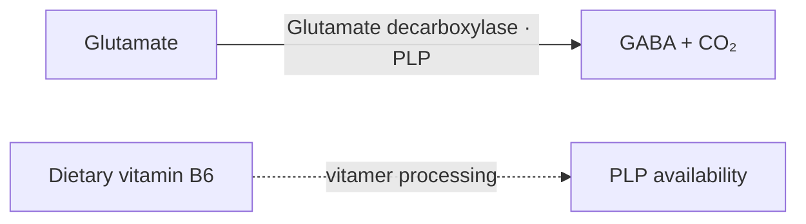

:::warning Demonstration only — not approved policy
This isolated page tests complementary dietary and biochemical explanations. Accepted classifications are reproduced, not revised. Added reaction context is not an admitted dietary atom. The live PM, ontology, KC/iKC decisions and SOP admissions remain authoritative.
:::

[All four demonstrations](/docs/system/dietary-requirements-demo) · [Canonical BRS1-FM4-PM9](/docs/biological-targets/brs1/fm4/brs1-fm4-pm9-gaba-synthesis-capacity)

## Defined mechanism

**Canonical mission:** Maintain sufficient glutamate decarboxylase capacity, and sufficient PLP cofactor to support it, so GABA can be synthesised from glutamate.

The diagram identifies selected relationships; it is not a complete stoichiometric or whole-PM inventory. Dashed supply arrows do not assert quantitative conversion yields. [Accepted reaction/pathway evidence](/docs/biological-targets/brs1/fm4/brs1-fm4-pm9-gaba-synthesis-capacity#pm9-f1).

## 1.1 Dietary Requirements

Nutrition maintains capacity; the body also produces and regenerates reaction participants. Insufficiency, adequate provision and therapeutic enhancement are separate propositions. This parent heading does not make every participant below a dietary intake requirement.

### 1.1.1 Direct and/or Derived Dietary Requirements

**What nutrition provides.** Current accepted classifications are retained, including disagreements explicitly flagged below.

| Accepted input | Current classification | Dietary provision explanation — demonstration wording | Source decision and limitation | Evidence |
| --- | --- | --- | --- | --- |
| Pyridoxal 5′-phosphate (PLP; active vitamin B6 cofactor) | direct | PLP is the active cofactor target required by GAD. The current source retains Direct classification while independent dietary PLP supply is not established. This is a classification-review entry, not an instruction to consume PLP separately. | Unset in source — classification review; The evidence establishes PLP dependence of GAD, but not dietary PLP provision or an intake-to-synthesis response in humans. | [PM9-F1: Vitamin B6 supports the enzyme that makes GABA](/docs/biological-targets/brs1/fm4/brs1-fm4-pm9-gaba-synthesis-capacity#pm9-f1) |
| Vitamin B6 | derived → PLP | Dietary B6 vitamers support formation of PLP used by GAD. The accepted relationship is Derived → PLP and is not GABA-specific. Additional B6 increasing human neuronal GABA synthesis is not established. | Yes; Dietary B6 provision of PLP precursors is supported, but increasing B6 intake has not been shown to increase human brain GABA synthesis; PLP supports many enzymes and is not GABA-specific. | [PM9-F1: Vitamin B6 supports the enzyme that makes GABA](/docs/biological-targets/brs1/fm4/brs1-fm4-pm9-gaba-synthesis-capacity#pm9-f1); [PM9-F2: How vitamin B6 becomes active — and why that is not GABA-specific](/docs/biological-targets/brs1/fm4/brs1-fm4-pm9-gaba-synthesis-capacity#pm9-f2) |

### 1.1.2 Cofactors and Substrates

**What the mechanism uses, and how availability is maintained.** Reaction context below is separated from admitted dietary supply. Repetition is justified only by the additional explanation in the fourth column.

| Participant | Biochemical role and step | Supply or regeneration | Information added beyond §1.1.1 | Evidence |
| --- | --- | --- | --- | --- |
| Glutamate | Immediate substrate: GAD decarboxylates glutamate to GABA and CO₂. | Neuronal endogenous glutamate pools; the accepted evidence does not establish dietary glutamate control of this pool. | Explains the consumed reactant without admitting a glutamate-eating strategy. | [PM9-F1: Vitamin B6 supports the enzyme that makes GABA](/docs/biological-targets/brs1/fm4/brs1-fm4-pm9-gaba-synthesis-capacity#pm9-f1) |
| PLP | Active GAD cofactor: Supports decarboxylation; GAD cofactor occupancy can differ between enzyme forms. | B6 vitamer processing maintains PLP; allocation and enzyme binding matter. | Dietary precursor provision above; reaction-specific cofactor use here. The current double presentation of one atom is tested with separate explanations. | [PM9-F1: Vitamin B6 supports the enzyme that makes GABA](/docs/biological-targets/brs1/fm4/brs1-fm4-pm9-gaba-synthesis-capacity#pm9-f1) |

### 1.1.3 Key Constraints

Existing identifiers, ownership and limitations are retained. An upstream supply or pool connection is not newly classified Direct/Derived. Pools are not additional nutrient quantities.

No structured PM↔KC relationship is present in this source. No KC is invented for the demonstration.

## SOP boundary

No structured SOP is admitted on this PM. The existing high-dose B6 anxiety study did not measure GABA, GAD, PLP or synthesis flux; it does not automatically establish a GABA-synthesis optimisation practice.

:::info Demonstration review notes
- Glutamate remains biochemical context, not a newly admitted dietary requirement.
- PLP and B6 are linked target and supply route, not two independent nutritional requirements.
- GABA concentration, synthesis flux and clinical outcomes are different endpoints. Preserve the existing GAD-form and cofactor-occupancy qualifications.
- No quantitative dietary targets, precursor yields, new food lists or therapeutic benefits are inferred.
- Proposed reaction explanations remain preview-only until reviewed.
:::

Accepted dietary records and evidence — source audit

Source: `docs/biological-targets/brs1/fm4/brs1-fm4-pm9-gaba-synthesis-capacity.mdx`. Snapshot hash: `8344631c7e1b1fe3227b7be6a5e001956d8b99f60a3c7426155d3c70a3d75924`. Reproduce these previews with `node scripts/generate-dietary-requirements-demos.mjs`; do not maintain a separate scientific registry here.

### PM9-DIT-2: Pyridoxal 5′-phosphate (PLP; active vitamin B6 cofactor)

- Accepted biological role: Required cofactor for GAD-dependent conversion of glutamate to GABA
- Accepted layer: dietary-requirement; addressability: not-established; ceiling: biological-dependency.
- Limitation: The evidence establishes PLP dependence of GAD, but not dietary PLP provision or an intake-to-synthesis response in humans.
- Supply links: None on this atom.
- Source evidence: [PM9-F1: Vitamin B6 supports the enzyme that makes GABA](/docs/biological-targets/brs1/fm4/brs1-fm4-pm9-gaba-synthesis-capacity#pm9-f1)
- References: [martin_regulation_1993](/docs/papers/BRAIN-Diet-References#martin_regulation_1993)

### PM9-DIT-3: Vitamin B6

- Accepted biological role: Provides dietary B6 vitamers that pyridoxal kinase converts to PLP, the cofactor required for GAD-dependent GABA synthesis
- Accepted layer: dietary-requirement; addressability: precursor-mediated; ceiling: dietary-provision.
- Limitation: Dietary B6 provision of PLP precursors is supported, but increasing B6 intake has not been shown to increase human brain GABA synthesis; PLP supports many enzymes and is not GABA-specific.
- Supply links: None on this atom.
- Source evidence: [PM9-F1: Vitamin B6 supports the enzyme that makes GABA](/docs/biological-targets/brs1/fm4/brs1-fm4-pm9-gaba-synthesis-capacity#pm9-f1); [PM9-F2: How vitamin B6 becomes active — and why that is not GABA-specific](/docs/biological-targets/brs1/fm4/brs1-fm4-pm9-gaba-synthesis-capacity#pm9-f2)
- References: [martin_regulation_1993](/docs/papers/BRAIN-Diet-References#martin_regulation_1993); [lee_human_2000](/docs/papers/BRAIN-Diet-References#lee_human_2000); [tang_crystal_2005](/docs/papers/BRAIN-Diet-References#tang_crystal_2005); [navarro_catalytic_2013](/docs/papers/BRAIN-Diet-References#navarro_catalytic_2013)

