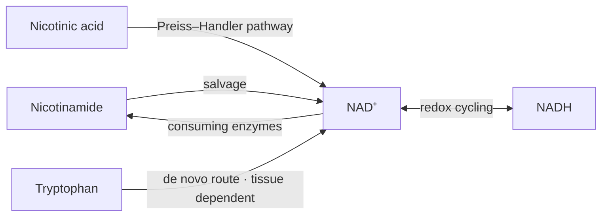

:::warning Demonstration only — not approved policy
This isolated page tests complementary dietary and biochemical explanations. Accepted classifications are reproduced, not revised. Added reaction context is not an admitted dietary atom. The live PM, ontology, KC/iKC decisions and SOP admissions remain authoritative.
:::

[All four demonstrations](/docs/system/dietary-requirements-demo) · [Canonical BRS4-FM1-PM2](/docs/biological-targets/brs4/fm1/brs4-fm1-pm2-nad-metabolism)

## Defined mechanism

**Canonical mission:** Maintain NAD⁺ availability so redox reactions and mitochondrial signalling stay adequately powered.

The diagram identifies selected relationships; it is not a complete stoichiometric or whole-PM inventory. Dashed supply arrows do not assert quantitative conversion yields. [Accepted reaction/pathway evidence](/docs/biological-targets/brs4/fm1/brs4-fm1-pm2-nad-metabolism#pm2-f1).

## 1.1 Dietary Requirements

Nutrition maintains capacity; the body also produces and regenerates reaction participants. Insufficiency, adequate provision and therapeutic enhancement are separate propositions. This parent heading does not make every participant below a dietary intake requirement.

### 1.1.1 Direct and/or Derived Dietary Requirements

**What nutrition provides.** Current accepted classifications are retained, including disagreements explicitly flagged below.

| Accepted input | Current classification | Dietary provision explanation — demonstration wording | Source decision and limitation | Evidence |
| --- | --- | --- | --- | --- |
| Nicotinamide (a form of vitamin B3) | direct | Dietary nicotinamide supplies an entry substrate for NAD⁺ salvage. Endogenous nicotinamide also supplies this route. Salvage capacity does not establish that pharmacological supplementation benefits adequately nourished people. | Yes; The review identifies the salvage substrate. It does not show that eating more nicotinamide, once intake is adequate, raises NAD⁺. The myopathy niacin study used nicotinic acid at pharmacological doses. | [PM2-F1: Three major pathways maintain the NAD⁺ pool](/docs/biological-targets/brs4/fm1/brs4-fm1-pm2-nad-metabolism#pm2-f1) |
| Nicotinic acid (a form of vitamin B3) | direct | Dietary nicotinic acid supplies the accepted Preiss–Handler entry route. Its current Direct classification refers to that accepted precursor input. High-dose niacin results in mitochondrial myopathy do not establish ordinary-intake cognitive benefit. | Yes; In five adults with mitochondrial myopathy, niacin at 750–1,000 mg/day raised blood NAD⁺ and brought muscle NAD⁺ to the control level. That is medical dosing in a deficiency disease, not a result for adequate everyday intake, and attention was not measured. | [PM2-F1: Three major pathways maintain the NAD⁺ pool](/docs/biological-targets/brs4/fm1/brs4-fm1-pm2-nad-metabolism#pm2-f1); [PM2-F4: High-dose niacin raised NAD⁺ in myopathy](/docs/biological-targets/brs4/fm1/brs4-fm1-pm2-nad-metabolism#pm2-f4) |
| Tryptophan | derived → Nicotinamide (a form of vitamin B3) | Dietary tryptophan can support NAD⁺ precursor availability through the accepted de novo supply chain. The source classifies this as Derived to nicotinamide. Its contribution is tissue dependent and does not establish that additional protein raises NAD⁺. | Yes; Most cells outside the liver do not run the full route. The review does not establish what share of the NAD⁺ pool comes from tryptophan, and eating more protein is not shown to raise NAD⁺. | [PM2-F1: Three major pathways maintain the NAD⁺ pool](/docs/biological-targets/brs4/fm1/brs4-fm1-pm2-nad-metabolism#pm2-f1) |

### 1.1.2 Cofactors and Substrates

**What the mechanism uses, and how availability is maintained.** Reaction context below is separated from admitted dietary supply. Repetition is justified only by the additional explanation in the fourth column.

| Participant | Biochemical role and step | Supply or regeneration | Information added beyond §1.1.1 | Evidence |
| --- | --- | --- | --- | --- |
| Nicotinamide | Salvage-entry substrate: Enters the pathway that replenishes NAD⁺ consumed by signalling enzymes. | Dietary entry plus endogenous release during NAD⁺ consumption. | Distinguishes an ingested precursor from reuse of the same molecule within cells. | [PM2-F1: Three major pathways maintain the NAD⁺ pool](/docs/biological-targets/brs4/fm1/brs4-fm1-pm2-nad-metabolism#pm2-f1) |
| Nicotinic acid | Preiss–Handler entry substrate: Enters a separate biosynthetic route to NAD⁺. | Accepted dietary provision; intracellular pathway processing follows. | Explains why this precursor is not interchangeable with every salvage intermediate. | [PM2-F1: Three major pathways maintain the NAD⁺ pool](/docs/biological-targets/brs4/fm1/brs4-fm1-pm2-nad-metabolism#pm2-f1); [PM2-F4: High-dose niacin raised NAD⁺ in myopathy](/docs/biological-targets/brs4/fm1/brs4-fm1-pm2-nad-metabolism#pm2-f4) |
| Tryptophan | De novo entry substrate: Enters a multi-step biosynthetic route; the accepted record describes hepatic nicotinamide supply. | Dietary amino-acid availability; tissue-specific conversion. | Distinguishes conversion capacity from a quantitative contribution or intake response. | [PM2-F1: Three major pathways maintain the NAD⁺ pool](/docs/biological-targets/brs4/fm1/brs4-fm1-pm2-nad-metabolism#pm2-f1) |
| NAD⁺ / NADH | Redox coenzyme pair: Electron transfer interconverts NAD⁺ and NADH; consuming enzymes require separate replenishment. | Redox regeneration plus synthesis/salvage of the molecular pool. | PM2-F1/F2 context, not newly admitted NAD⁺/NADH dietary atoms. Recycling an oxidation state is not the same as rebuilding a consumed molecule. | [PM2-F1: Three major pathways maintain the NAD⁺ pool](/docs/biological-targets/brs4/fm1/brs4-fm1-pm2-nad-metabolism#pm2-f1) |

### 1.1.3 Key Constraints

Existing identifiers, ownership and limitations are retained. An upstream supply or pool connection is not newly classified Direct/Derived. Pools are not additional nutrient quantities.

No structured PM↔KC relationship is present in this source. No KC is invented for the demonstration.

## SOP boundary

No structured SOP is admitted on this PM. High-dose niacin in deficient mitochondrial-myopathy patients is intervention evidence with a restricted population and dose; it is not an ordinary-food sufficiency target or a general cognitive recommendation.

:::info Demonstration review notes
- This is a pathway-level demonstration, not an exhaustive reaction-by-reaction inventory. The source does not provide accepted atoms for every intermediate, ATP-dependent step or catalytic participant.
- Keep nicotinamide, nicotinic acid and tryptophan classifications unchanged. Review wording that could confuse a dietary precursor with the final coenzyme.
- A concise synthesis/salvage/redox explanation currently communicates more supported information than inventing a complete intermediate list. Detailed expansion would require bounded reaction-specific review.
- No quantitative dietary targets, precursor yields, new food lists or therapeutic benefits are inferred.
- Proposed reaction explanations remain preview-only until reviewed.
:::

Accepted dietary records and evidence — source audit

Source: `docs/biological-targets/brs4/fm1/brs4-fm1-pm2-nad-metabolism.mdx`. Snapshot hash: `5674da43ab6a672d5bae7174472157d356472316c14dd0e4fc2f6a20de05c243`. Reproduce these previews with `node scripts/generate-dietary-requirements-demos.mjs`; do not maintain a separate scientific registry here.

### PM2-DIT-1: Nicotinamide (a form of vitamin B3)

- Accepted biological role: Nicotinamide is the salvage substrate that NAMPT recycles toward NAD⁺.
- Accepted layer: dietary-requirement; addressability: direct; ceiling: biological-dependency.
- Limitation: The review identifies the salvage substrate. It does not show that eating more nicotinamide, once intake is adequate, raises NAD⁺. The myopathy niacin study used nicotinic acid at pharmacological doses.
- Supply links: None on this atom.
- Source evidence: [PM2-F1: Three major pathways maintain the NAD⁺ pool](/docs/biological-targets/brs4/fm1/brs4-fm1-pm2-nad-metabolism#pm2-f1)
- References: [covarrubias_nad_2021](/docs/papers/BRAIN-Diet-References#covarrubias_nad_2021)

### PM2-DIT-2: Nicotinic acid (a form of vitamin B3)

- Accepted biological role: Nicotinic acid is the Preiss–Handler substrate that cells convert toward NAD⁺.
- Accepted layer: dietary-requirement; addressability: direct; ceiling: biological-dependency.
- Limitation: In five adults with mitochondrial myopathy, niacin at 750–1,000 mg/day raised blood NAD⁺ and brought muscle NAD⁺ to the control level. That is medical dosing in a deficiency disease, not a result for adequate everyday intake, and attention was not measured.
- Supply links: None on this atom.
- Source evidence: [PM2-F1: Three major pathways maintain the NAD⁺ pool](/docs/biological-targets/brs4/fm1/brs4-fm1-pm2-nad-metabolism#pm2-f1); [PM2-F4: High-dose niacin raised NAD⁺ in myopathy](/docs/biological-targets/brs4/fm1/brs4-fm1-pm2-nad-metabolism#pm2-f4)
- References: [covarrubias_nad_2021](/docs/papers/BRAIN-Diet-References#covarrubias_nad_2021); [pirinen_niacin_2020](/docs/papers/BRAIN-Diet-References#pirinen_niacin_2020)

### PM2-DIT-3: Tryptophan

- Accepted biological role: The liver can convert tryptophan to nicotinamide, which other cells salvage into NAD⁺.
- Accepted layer: dietary-requirement; addressability: precursor-mediated; ceiling: biological-dependency.
- Limitation: Most cells outside the liver do not run the full route. The review does not establish what share of the NAD⁺ pool comes from tryptophan, and eating more protein is not shown to raise NAD⁺.
- Supply links: None on this atom.
- Source evidence: [PM2-F1: Three major pathways maintain the NAD⁺ pool](/docs/biological-targets/brs4/fm1/brs4-fm1-pm2-nad-metabolism#pm2-f1)
- References: [covarrubias_nad_2021](/docs/papers/BRAIN-Diet-References#covarrubias_nad_2021)

